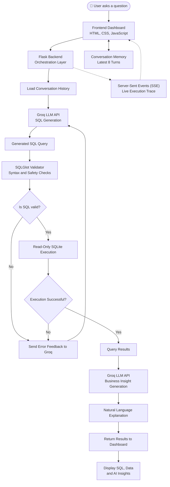

# Veloura Chocolates
### AI-Powered Conversational SQL Agent for Business Data Analysis

Veloura Chocolates is an AI-powered business intelligence application that allows users to interact with a business database using natural language. Instead of manually writing SQL queries, users can simply ask questions about sales, customers, products, employees, and ingredients.

The system uses a Large Language Model (LLM) to translate natural language questions into SQL queries, validates the generated SQL, executes approved queries against a SQLite database, and presents the results along with AI-generated business insights.

---

## ✨ Key Features

### 1. Natural Language to SQL
- Ask business questions using everyday language.
- Automatically generates SQL queries using the Groq API.
- Supports analytical questions involving multiple database tables.

### 2. SQL Validation and Self-Correction
- Uses SQLGlot to parse and validate generated SQL.
- Restricts database operations to read-only queries.
- Checks query validity before execution.
- Attempts to correct invalid queries using AI-assisted error feedback.

### 3. Live Agent Execution Trace
- Displays the agent's execution process in real time.
- Uses Server-Sent Events (SSE) to stream progress updates.
- Shows stages such as:
  - Understanding the question
  - Generating SQL
  - Validating the query
  - Executing the database query
  - Generating business insights

### 4. AI-Generated Business Insights
- Explains query results in natural language.
- Highlights useful patterns and findings.
- Makes database information easier to understand.

### 5. Conversational Follow-Up Memory
- Maintains recent conversation context.
- Allows users to ask follow-up questions without repeating previous context.
- Supports contextual questions such as "What about the second product?"
- Stores the latest eight conversation turns in frontend memory.

### 6. Interactive Dashboard
- Displays generated SQL queries.
- Presents database results in structured tables.
- Provides AI-generated explanations.
- Includes example questions and follow-up suggestions.
- Features a responsive, chocolate-themed interface.

---

## 🛠️ Technology Stack

| Component | Technology |
|---|---|
| Backend | Python, Flask |
| AI / LLM | Groq API |
| AI Model | `openai/gpt-oss-120b` |
| Database | SQLite |
| SQL Validation | SQLGlot |
| Database Access | Python SQLite3 |
| Frontend | HTML, CSS, JavaScript |
| Templating | Jinja2 |
| Live Updates | Server-Sent Events (SSE) |
| Compression | Zstandard |

---

## 🏗️ System Architecture

The application uses Flask as its central orchestration layer, coordinating the LLM, SQL validator, SQLite database, and frontend.



### Workflow Overview

1. **User Input:** The user submits a business question through the dashboard.
2. **Orchestration:** Flask receives the request and retrieves recent conversation context.
3. **SQL Generation:** Groq generates an SQL query based on the user's question.
4. **SQL Validation:** SQLGlot checks the generated query for syntax and safety.
5. **Self-Correction:** Invalid queries or execution errors are sent back to Groq for correction, with a limited retry.
6. **Database Execution:** Valid queries are executed against SQLite using read-only access.
7. **Insight Generation:** Groq interprets the query results and generates a natural-language explanation.
8. **Live Updates:** SSE streams execution progress to the frontend.
9. **Result Presentation:** The dashboard displays the generated SQL, database results, and AI-generated insights.
10. **Conversation Memory:** Recent interactions are retained to support contextual follow-up questions.

## 🗄️ Database Structure

The project uses an SQLite database containing seven main tables:

| Table | Description |
|---|---|
| `customers` | Customer information |
| `products` | Chocolate product details |
| `orders` | Customer order records |
| `order_items` | Individual products within orders |
| `employees` | Employee information |
| `ingredients` | Ingredient details |
| `product_ingredients` | Many-to-many relationship between products and ingredients |

### Database Scale

The database contains approximately:

- 10,000 customers
- 200 products
- 1,000,000 orders
- 2,000,000+ order items
- 40 employees
- 50 ingredients
- 1,042 product-ingredient relationships

---

## 📁 Project Structure

```text
cocoa-co-ai/
│
├── app.py
├── database.py
├── generate_database.py
├── requirements.txt
├── .gitignore
├── README.md
│
├── data/
│   ├── cocoa_co_customers_v2.csv
│   ├── cocoa_co_products.csv
│   ├── cocoa_co_ingredients.csv
│   ├── cocoa_co_product_ingredients.csv
│   └── cocoa_co_employees_final.csv
│
├── templates/
│   ├── base.html
│   └── dashboard.html
│
└── static/
    └── style.css
```

---

## ⚙️ Installation and Setup

### 1. Clone the Repository

```bash
git clone <YOUR_REPOSITORY_URL>
cd cocoa-co-ai
```

### 2. Create a Virtual Environment

```bash
python -m venv venv
```

Activate it:

**Windows:**
```bash
venv\Scripts\activate
```

**macOS / Linux:**
```bash
source venv/bin/activate
```

### 3. Install Dependencies

```bash
pip install -r requirements.txt
```

### 4. Configure Environment Variables

Create a `.env` file in the project root:

```env
GROQ_API_KEY=your_groq_api_key_here
```

Obtain your API key from the Groq developer platform:

https://console.groq.com/

### 5. Prepare the Database

Ensure that the SQLite database is available in the project root.

If you are generating the database from the provided CSV files, run:

```bash
python generate_database.py
```

If using the compressed database distribution, ensure `database.db.zst` is placed in the expected location. The application includes database restoration logic.

### 6. Run the Application

```bash
python app.py
```

Open your browser and visit:

```text
http://127.0.0.1:5000
```

---

## 💬 Example Questions

Users can ask questions such as:

- What are our 10 highest-revenue products?
- Which city generates the most revenue?
- What is our average order value?
- Which ingredient is used by the most products?
- Which customers have placed the most orders?
- Which products generate the highest sales?

Follow-up questions can also use the context of previous queries.

---

## 🔒 Security and Reliability

The application implements multiple safeguards to reduce the risk of unsafe SQL execution:

- SQLGlot-based query parsing and validation.
- Read-only SQLite database connections.
- SQLite query-only mode.
- SQLite authorizer restrictions.
- Rejection of unsupported write operations.
- Single-statement query enforcement.
- Query validation before execution.
- A maximum limit on returned result rows.

These safeguards are designed to prevent the AI agent from modifying the database through generated SQL.

---

## 🚀 Future Improvements

Potential future enhancements include:

- Interactive charts and data visualizations.
- Exporting query results to CSV and Excel.
- Persistent conversation history.
- Advanced business forecasting.
- Query execution time monitoring.
- Role-based access control.
- More sophisticated query optimization.

---

## 🎯 Project Objective

The primary objective of Veloura Chocolates is to demonstrate how Large Language Models can simplify database interaction by allowing users to communicate with structured business data through natural language.

By combining AI-powered SQL generation, query validation, database execution, and natural-language explanations, the application provides an accessible approach to conversational business intelligence.

---

**Veloura Chocolates | AI-Powered Business Intelligence**

*Turning business questions into meaningful insights.* 🍫
